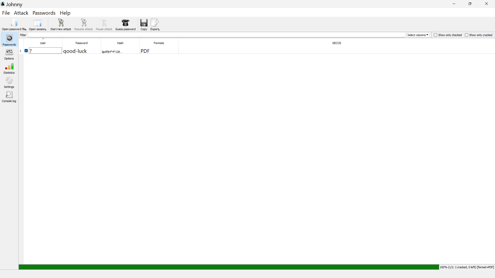
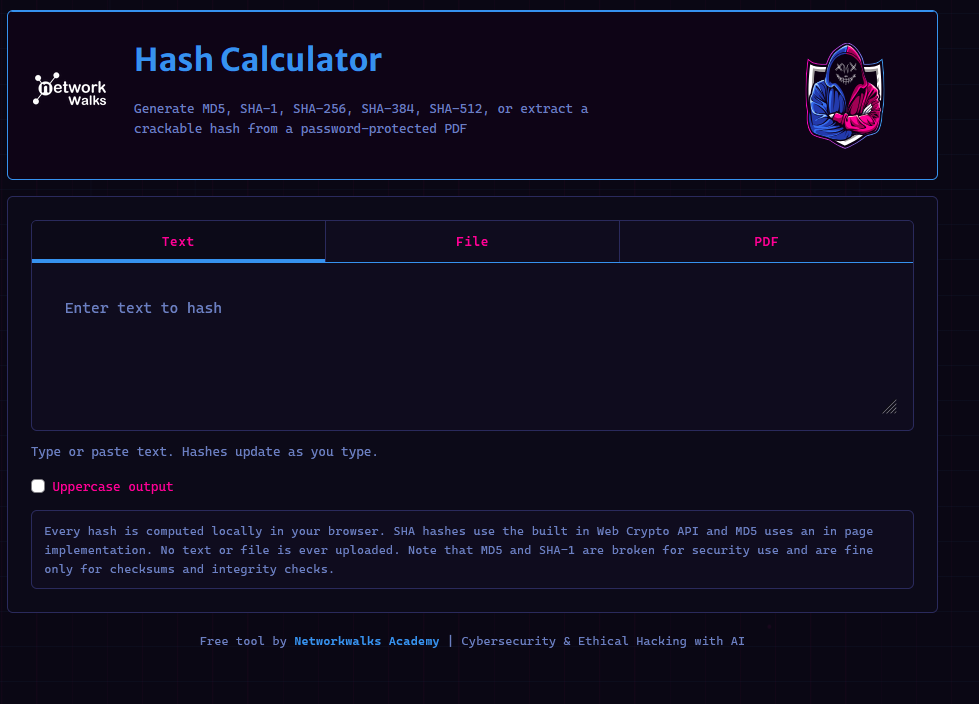

# Week 3 – Password Cracking | Cybersecurity & Ethical Hacking Internship

**Organization:** NetworkWalks  
**Project:** Password Cracking with John the Ripper and NetworkWalks Tools  
**Week:** 03

## Overview

This project focuses on understanding and performing password recovery techniques on password-protected PDF files using John the Ripper (JTR) and NetworkWalks tools.

The practical exercises involved generating and extracting PDF password hashes, performing dictionary-based attacks, and verifying recovered passwords.

## Tools Used

- **John the Ripper (Johnny GUI)** – Password cracking.
- **Online Hash Crack** – Generating PDF password hashes.
- **NetworkWalks Hash Calculator** – PDF hash extraction.
- **NetworkWalks Password Cracking Tool** – Dictionary-based password recovery.

## Practical Implementation

### 1. Password Cracking with John the Ripper

- Generated and extracted the PDF password hash.
- Loaded the extracted hash into Johnny.
- Performed a password recovery attack.
- Successfully recovered and verified the password.

### 2. Password Cracking with NetworkWalks Tools

- Used the NetworkWalks Hash Calculator to extract the PDF hash.
- Loaded the hash into the password cracking tool.
- Performed a dictionary attack using the built-in wordlist.
- Identified a matching password and verified the result.

## Evidence

### 1. John the Ripper (Johnny)
Password cracking process and recovered password using Johnny.

### 2. NetworkWalks Hash Calculator
Generating and extracting the PDF password hash.

### 3. NetworkWalks Password Cracking Tool
Performing a dictionary-based password attack using NetworkWalks tools.

### 4. Extracted PDF Hash
The extracted hash used during the password cracking exercise.

[hash1.txt](evidence/hash1.txt)

### 5. Password-Protected PDF
The PDF file used for the NetworkWalks password cracking exercise.

[My Locked PDF1 (for NW Tools)](evidence/My_Locked_PDF1_(for_NW_Tools).pdf)
## Key Learnings

- Understanding password hashing and PDF hash formats.
- Generating and extracting PDF password hashes.
- Working with John the Ripper (Johnny).
- Understanding dictionary-based password attacks.
- Using wordlists for password recovery.
- Verifying recovered passwords.

## Disclaimer

This project was completed for educational purposes as part of my cybersecurity internship at NetworkWalks. All activities were performed in a controlled lab environment using test files.

## 👤 Author

**Raj Ghimire**  
Cybersecurity & Ethical Hacking Intern  
NetworkWalks | Batch B084
